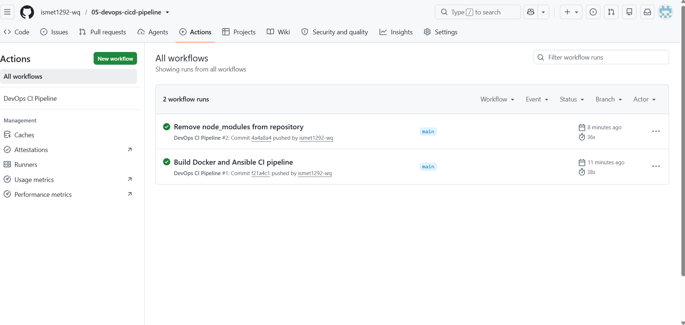
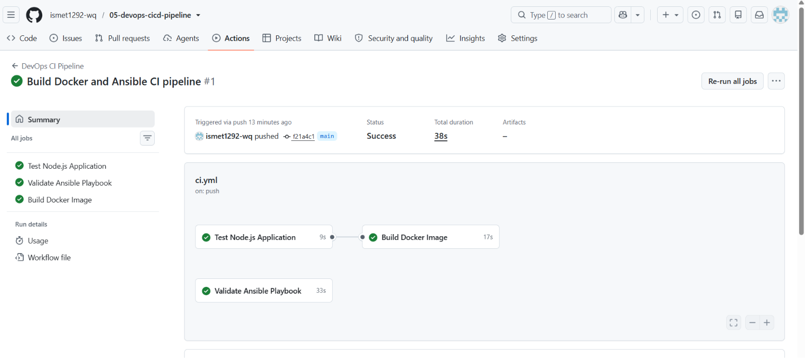
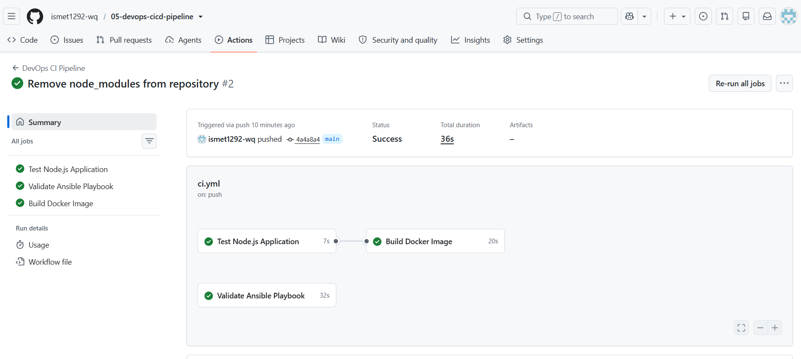

# DevOps CI/CD Pipeline

Project 05 in Ismet Xani's portfolio. GitHub Actions tests a Node.js API,
builds a commit-tagged Docker image, deploys it through Ansible and Docker
Compose on a disposable runner, verifies it, and removes the demonstration.

## Pipeline

1. Install locked application dependencies and test actual HTTP responses.
2. Check Ansible syntax and the Compose configuration.
3. Build the image tagged with the triggering Git commit.
4. Use Ansible to start the container and wait for Docker health checks.
5. Deploy again and require an unchanged Ansible recap.
6. Inspect actual container health, image tag, non-root UID, read-only filesystem,
   loopback publication, and the production environment response.
7. Attempt an intentionally broken candidate and require deployment to fail.
8. Restore the original image ID and verify Docker health and HTTP recovery.
9. Collect logs on failure and run Compose cleanup even when a check fails.

This is continuous integration with a real disposable deployment test. It does
not publish an image, deploy to AWS, retain a public application, or
automatically promote releases to production. The image tag traces
the commit; the Node base image tag is mutable and builds are not byte-for-byte
reproducible. No cloud credentials or registry write permissions are required.

## Application tests in PowerShell

```powershell
cd app
npm ci
npm test
```

Tests start the HTTP server on an ephemeral loopback port and check the root
payload, health response, unknown route, and absence of the Express identifying
header. Importing the application does not start a server.

## Isolated deployment demonstration

Requires Linux, Docker Engine with Compose v2 supporting --wait, Python 3.12+
and ansible-core 2.20.1. Docker access is highly privileged; use a disposable
lab host or the GitHub runner. The local inventory targets the machine where
Ansible runs. The workflow was designed to test this without changing WSL.

From the repository root in a Linux shell:

```bash
export PROJECT_IMAGE=project05-demo:local
docker build -t "$PROJECT_IMAGE" .
python3 scripts/verify-deployment.py
docker compose --project-name project05-demo down --remove-orphans
```

Use an unused local port 13000. Compose publishes only 127.0.0.1:13000, starts
the image as its non-root user, drops capabilities, limits resources and logs,
and makes the root filesystem read-only with a temporary /tmp. The service
has no data volume. The cleanup command removes this Compose project's
containers and network; the built image remains cached on a local machine.
Hosted runners are discarded after the job. Abrupt runner cancellation may
prevent the cleanup step from running, but no persistent server is provisioned.

Ansible reports changes from Compose lifecycle messages; the end-to-end test
also requires a successful unchanged second run. This does not establish
general-purpose drift reconciliation across every Docker Compose version.
Check mode does not deploy the container and is not a deployment test.

## Evidence and limits

See [GitHub Actions](https://github.com/ismet1292-wq/05-devops-cicd-pipeline/actions)
for actual results on each commit. Local JavaScript syntax validation passed.
Automated approval review rejected the combined local edit-and-test command;
deployment validation therefore runs only on the disposable runner.

The app is a demonstration API with no database, authentication, TLS, remote
production deployment, load testing, or security audit.

## Failed release and rollback demonstration

After the normal deployment checks, scripts/verify-rollback.py builds a local
candidate derived from the tested image whose command exits with code 1. It
requires Compose's deployment check to fail and inspects the failed container
to confirm the intended candidate caused that failure. A finally block restores
the known-good image even if the experiment fails. Verification compares the
restored runtime image ID with the original image ID and checks both Docker
health and the actual HTTP health payload. CI then removes the container and
network using its normal cleanup step.

This is an explicit recovery experiment with downtime. It does not implement
zero-downtime promotion, a general production rollback controller, or database
migration recovery. Abrupt runner termination can prevent the finally block
from running; the runner is disposable and no persistent host is provisioned.

## Earlier CI screenshots

These screenshots were added before the disposable deployment test. They record
previous workflow runs; use the current Actions run for the expanded checks.




